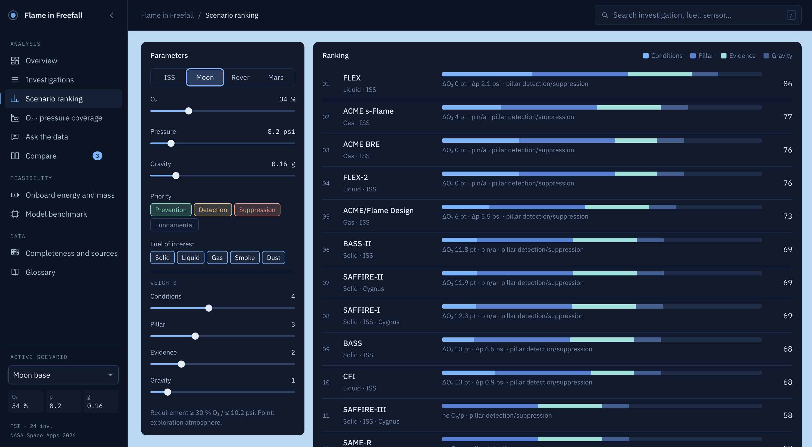

# Flame Waypoint

NASA Space Apps Challenge 2026 · **Flame in Freefall** · Team **Pyromancer**

A discovery tool for NASA Physical Sciences Informatics (PSI) microgravity combustion data:
search, compare and rank investigations by relevance to spacecraft and Moon base fire-safety conditions,
using a local open-weights LLM.

**Live dashboard:** <https://sora-com.github.io/flame-waypoint/>
**Slides:** (https://docs.google.com/presentation/d/1xlX4BvFT6F8LGaG8SBowGrN8TJy0ozzQ/edit?usp=sharing&ouid=104276560482619359388&rtpof=true&sd=true) 



## What we are solving

Combustion Science is a rapidly growing aspect of science in space. Many experiments have been done, but they are not organized and the data is raw. Because of that, studying them is quite difficult, and it may lead to loss of knowledge. Since humankind is increasingly leaning towards the stars, this data is crucial for our safety and development in space. Flame Waypoint aims to aid engineers and scientists in this task.

## What it does

- **Investigations:** 24 PSI combustion investigations with their fuels, test conditions (oxygen, pressure,
  flow) and paper findings, each linked to its source.
- **Scenario ranking:** ranks investigations by how close their tests are to a design atmosphere
  (ISS, Moon base, pressurized rover, Mars, or a custom one).
- **O₂ · pressure coverage:** map of every tested condition against the Moon base requirement
  (≥ 30 % O₂ at ≤ 10.2 psi), showing what has and has not been tested.
- **Compare:** side-by-side view of selected investigations.
- **Ask the data:** natural-language questions answered by a local model, with citations
  (pre-computed answers on the public site, live when run locally, see below).
- **Onboard energy and mass:** what running the model on board in a spacecraft would cost.
- **Model benchmark:** accuracy and speed of the local models we tested.
- **Completeness and sources:** which data each investigation has, and where it comes from.
- **Glossary** of combustion terms.

We prioritized indepence from Earth in this project and, due to this, all SI agents are run locally. This is so that in case there are more experiments in space (which they will), operators do not depend on having connection to the ground. In addition, this reduces token cost and also provides reliability to the system. This is why we measured the energy consumption of different models in order to give engineers and space teams an idea of what energy budget to have in mind.

## How it works

1. **Fetch:** investigation metadata from the PSI repository, and the NASA papers behind each investigation
   from the NASA Technical Reports Server (NTRS). All the software is made to contemplate the addition of new investigations in the future.
2. **Parse test tables:** PSI test-matrix files (CSV/XLSX) are read in Python, without an LLM:
   1,681 test records, each citing its file and row.
3. **Extract with a local LLM:** `mistral-nemo` (via Ollama) extracts fuels, conditions and findings from
   metadata and papers. Every value keeps the sentence it came from; checks in Python reject values that
   are not in the source text.
4. **Build:** everything is joined into one file, `web/data/site.json`, read by a static dashboard
   (plain HTML/CSS/JS, no framework) published on GitHub Pages.

| Step | Command |
|------|---------|
| Fetch PSI metadata | `python3 -m pipeline.fetch.psi` |
| Find and download NTRS papers | `python3 -m pipeline.fetch.ntrs` |
| Parse PSI test tables | `python3 -m pipeline.fetch.psi_tables` |
| LLM extraction | `python3 -m pipeline.extract.run` |
| Coverage report | `python3 -m pipeline.report.coverage` |
| Build dashboard data | `python3 -m pipeline.build.site_data --include-tables` |
| Tests | `python3 -m unittest discover -s tests -t .` |

## Ask the data locally
The public dashboard shows **pre-computed** answers in *Ask the data*. Asking your own questions in natural
language **requires downloading and running the assistant on your computer**.

### Requirements
- [Ollama](https://ollama.com), the local model runtime.
- A model: `mistral-nemo` (default, one-time download of about 7 GB, needs about 10 GB of free memory) or
  `ministral-3:3b` (about 3 GB, faster but less accurate).
- Python 3.10 or later. Only the standard library is used: there is nothing to `pip install`.

### Run it
```sh
git clone https://github.com/Sora-com/flame-waypoint.git
cd flame-waypoint
ollama pull mistral-nemo              # one-time download
python3 -m pipeline.ask.server        # keep this terminal open
```

Open <http://localhost:8000/#/ask> (or press `0` anywhere in the dashboard). The label next to the title
reads **live · mistral-nemo on this computer** when the model is reachable. Type a question, or click one of
the suggested questions, for example:

- *What is the lowest pressure tested at 30 % oxygen or more, and in which experiment?*
- *Which experiments burned solid materials, and at what flow speeds?*
- *Which materials were burned in Saffire-II and what was learned?*

The whole dashboard is served from the same address, so the other views work as usual.

Options:

```sh
python3 -m pipeline.ask.server --model ministral-3:3b   # smaller model (run `ollama pull ministral-3:3b` first)
python3 -m pipeline.ask.server --port 8080              # another port
```

The assistant can also be called without the dashboard:

```sh
curl -s localhost:8000/api/ask -H 'Content-Type: application/json' \
     -d '{"question": "Which experiments used oxygen concentrations above 21 %?"}'
```

### How to read an answer
- Each statement cites its source: `[PSI-69]` opens the investigation, `[ntrs:…]` links to the NASA paper and
  `[glossary]` refers to the dashboard glossary.
- Numbers such as ranges, rankings, completeness and the distance to each scenario are computed in Python
  from the data; the model only phrases them. For ambiguous questions ("most complete", "most similar") it
  states the criterion it used.
- A yellow **Not found in the cited sources** note marks statements containing words or numbers that the
  cited sources do not contain. Treat those statements as unverified.
- *Context given to the model* shows exactly what the model saw.
- The footer gives the time, the tokens and an energy estimate. Each answer takes about 10–15 s with
  `mistral-nemo` on an Apple M3 Pro, and that cost is included in the dashboard's energy budget.

Everything runs offline: no question or data leaves your computer.

### Troubleshooting
- *Label says "pre-computed answers"*: the page is not served by `pipeline.ask.server`, or Ollama is not
  running. Start Ollama (open the app, or run `ollama serve`) and reload the page.
- *"model not available" warning when starting*: run `ollama pull mistral-nemo`, or the model passed
  with `--model`.
- *The first answer is slow*: the model is loaded into memory on the first question (about 10 s).

### Maintainers: refresh the pre-computed answers
After the data changes, regenerate the answers published on the public dashboard and review them:

```sh
python3 -m pipeline.ask.demo                        # writes data/ask/demo.json
python3 -m pipeline.build.site_data --include-tables  # local preview; GitHub Pages rebuilds on push
```

## Limitations
<!-- TODO: review; judges value honesty here. -->
- Only 24 Combustion Science investigations; some have no test table or no linked paper
  (see *Completeness and sources*). This is a demo, and the main infrastructure has been tested and verified, but it is not a final version to work with.
- SI is non-deterministic. LLM extraction and answers can still be wrong. Values keep their source sentence so they can be checked,
  but the verification cannot catch every error (for example, a correct number paired with the wrong test).
- Energy figures are estimates for an Apple M3 Pro, not measurements on flight hardware.

## Data sources
- [NASA PSI Data Repository: Combustion Science](https://psi.nasa.gov/physci/repo/search?q=combustion)
- [NASA Technical Reports Server (NTRS)](https://ntrs.nasa.gov)

## Use of SI tools
<!-- TODO: required by Space Apps. Describe honestly, e.g.: -->
- **In the product:** `mistral-nemo` (open weights, run locally with Ollama) extracts data from the documents
  and answers questions in *Ask the data*.
- **During development:** Claude Opus 5.5 was used to assist coding and dependency management.

## Team
- Alicia Oliva: alicia.oliva.cota@gmail.com, as machine learning engineer.
- Paloma Aragón: p.aragon026@gmail.com, as frontend designer and QA.

## License
MIT
